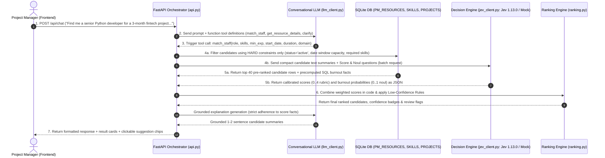

# AI Staffing Assistant (Prototype)

An intelligent staffing orchestrator that pairs conversational LLM intent classification with TypeSafe AI's **Jev System One** decision engine to deliver calibrated candidate rankings, burnout protection, and transparent confidence ratings for project managers.

---

## Architecture Flow

The system strictly executes the 7-step orchestrated pipeline:



---

## Key Features

1. **Deterministic SQL Hard Filtering**:
   - Evaluates active status, required skill overlap, date window overlap, and available allocation capacity.
   - Computes workload facts in SQL: `current_allocation_pct`, `concurrent_projects_count`, `hours_last_4_weeks`, and `recent_overtime_hours`.
   - Pre-ranks and caps candidates at the top 40.
2. **TypeSafe Jev Decision Engine (System One)**:
   - Pinned to `jev-1.13.0` (avoiding version shifts from `jev-latest`).
   - Batches candidate summaries into a 32K context window.
   - Evaluates:
     - `score`: Ordered 0 to 4 rubric evaluating domain expertise and skill depth.
     - `noul`: Boolean probability assessing burnout and context-switching risks based on factual workload numbers.
   - Includes **Mock Mode** (`JEV_MOCK=true`) delivering the exact same JSON response shape for offline development.
3. **Conversational LLM with Multi-Provider Fallback**:
   - Supports Google Gemini (Free Flash), Groq (Free Llama 3.3), OpenRouter (Free tier models ending in `:free`), and Ollama (Local).
   - If all LLMs fail or are unconfigured, automatically falls back to an internal **Keyword & Regex Intent Parser** so the application is always 100% runnable.
4. **Low-Confidence Handling & Human-in-the-Loop Safeguards**:
   - `MIN_CONFIDENCE = 0.60`: Flags individual candidates with a colored confidence badge (Green: High, Amber: Moderate, Red: Low).
   - `TIE_MARGIN = 0.05`: If top-2 scores differ by < 0.05, marks group **"TOO CLOSE TO CALL"** with a "Needs PM review" tag.
   - **All Top-3 Low Confidence**: Halts confident recommendations, asks a clarifying question (e.g. regarding timeline, domain, or skills), and presents clickable action chips: *"Relax skill requirement"*, *"Change start date"*, *"Show anyway"*.
   - `HIGH_BURNOUT_PROB = 0.70`: Displays a **"Workload risk"** warning framed strictly around current project allocation (never personal/protected attributes).
   - LLM never invents scores; explanations are strictly grounded in data.
5. **Configurable Ranking Formula**:
   $$\text{Final Score} = w_1 \cdot \text{Skill}_{\text{norm}} + w_2 \cdot \text{Avail}_{\text{fit}} + w_3 \cdot (1 - \text{Burnout}_{\text{prob}}) + w_4 \cdot \text{Seniority}_{\text{fit}} - w_5 \cdot \text{Cost}_{\text{penalty}}$$
   - Weights configurable via `.env` (`WEIGHT_SKILL=0.35`, `WEIGHT_AVAILABILITY=0.25`, `WEIGHT_BURNOUT=0.20`, `WEIGHT_SENIORITY=0.15`, `WEIGHT_COST=0.05`).
6. **Role-Based Permission Stub**:
   - Field-level hiding: `hourly_cost` is masked when the user role is `recruiter`, and visible when role is `manager`.
7. **Single-Page UI**:
   - Chatbot widget with avatars, typing indicators, suggestion chips, and Accept/Reject buttons writing directly to `DECISION_LOG`.
   - Staffing Dashboard displaying 300 personnel, sortable columns, visual utilization bars, and score breakdown modal.
   - Persistent **"Models in Use"** panel displaying active providers, latency per step, Jev token usage, estimated cost, and billing links.

---

## Directory Structure

```
ai-staffing-assistant/
├── .env.example              # Environment variables template
├── .env                      # Active environment settings
├── requirements.txt          # Python dependencies
├── README.md                 # System documentation & runbook
├── eval.py                   # Benchmark agreement rate evaluation script
├── demo_scenarios.py         # 3 end-to-end automated demo scenarios
├── app/
│   ├── __init__.py
│   ├── config.py             # App configuration, weights, and thresholds
│   ├── logging_config.py     # Structured logging & step latency tracking
│   ├── logging.py            # Logging module alias
│   ├── db.py                 # SQLite schema, indexes, SQL filter & decision log
│   ├── seed.py               # Deterministic seed (300 resources, 60 projects, 924 allocations, 1597 skills)
│   ├── models.py             # Pydantic data schemas
│   ├── llm_client.py         # Gemini, Groq, OpenRouter, Ollama & Keyword fallback
│   ├── jev_client.py         # TypeSafe Jev API client, Mock engine, & Fallback scorer
│   ├── ranking.py            # Ranking formula & low-confidence rules
│   ├── orchestrator.py       # Central pipeline orchestrator
│   ├── api.py                # FastAPI endpoints & static file serving
│   └── static/
│       ├── index.html        # Single-page UI (Chatbot + Dashboard)
│       ├── app.css           # Premium styling & dark/light theme
│       └── app.js            # Client-side chat, filtering, sorting, & telemetry
└── tests/
    ├── __init__.py
    ├── test_sql_filtering.py # SQL constraint & burnout facts tests
    ├── test_ranking.py       # Formula weights & cost penalty tests
    ├── test_low_confidence.py# All 4 low-confidence rule test cases
    └── test_jev_mock.py      # Mock Jev output schema compliance test
```

---

## How to Get Free LLM Keys

The Conversational LLM supports multiple free options configured in `.env` via `LLM_PROVIDER`:

1. **Google AI Studio (Gemini Flash - Free Tier)**:
   - Visit: [https://aistudio.google.com/app/apikey](https://aistudio.google.com/app/apikey)
   - Click "Create API Key"
   - Add to `.env`:
     ```env
     LLM_PROVIDER=gemini
     GEMINI_API_KEY=your_gemini_api_key_here
     GEMINI_MODEL=gemini-2.0-flash
     ```
2. **Groq (Llama Models - Free Tier)**:
   - Visit: [https://console.groq.com/keys](https://console.groq.com/keys)
   - Sign up and click "Create API Key"
   - Add to `.env`:
     ```env
     LLM_PROVIDER=groq
     GROQ_API_KEY=your_groq_api_key_here
     GROQ_MODEL=llama-3.3-70b-versatile
     ```
3. **OpenRouter (Free Tier Models ending in `:free`)**:
   - Visit: [https://openrouter.ai/keys](https://openrouter.ai/keys)
   - Add to `.env`:
     ```env
     LLM_PROVIDER=openrouter
     OPENROUTER_API_KEY=your_openrouter_key_here
     OPENROUTER_MODEL=meta-llama/llama-3.3-70b-instruct:free
     ```
4. **Ollama (Fully Local, No Key Needed)**:
   - Install Ollama from [https://ollama.ai](https://ollama.ai)
   - Pull a model: `ollama run llama3.1` or `ollama run qwen2.5`
   - Add to `.env`:
     ```env
     LLM_PROVIDER=ollama
     OLLAMA_BASE_URL=http://localhost:11434
     OLLAMA_MODEL=llama3.1
     ```
5. **No Keys Configured / Offline Mode**:
   - If no API keys are set, the system automatically uses the internal **Keyword & Regex Intent Parser** (`KeywordRegex-v1`). All features remain 100% operational.

---

## How to Run in Mock Mode vs Real Jev

### Running in Mock Mode (Default)
In mock mode, the application uses a deterministic local decision engine that returns the exact same JSON format (scores, confidence, noul probabilities, legend, and usage):
- In `.env`:
  ```env
  JEV_MOCK=true
  TYPESAFE_API_KEY=
  JEV_MODEL=jev-1.13.0
  ```
- The frontend will display a visible red/amber **"MOCK MODE - not real Jev"** badge.

### Switching to Live TypeSafe Jev API
1. Acquire an API key from the TypeSafe Console:
   - Console: [https://console.typesafe.ai](https://console.typesafe.ai)
   - API Keys: [https://console.typesafe.ai/settings/keys](https://console.typesafe.ai/settings/keys)
   - Alternative with no separate waitlist: **Vercel AI Gateway** (model id `typesafe-ai/jev`, billed through Vercel): [https://vercel.com/ai-gateway](https://vercel.com/ai-gateway)
   > *Note: Pricing is $0.042 per 1,000,000 input tokens; output tokens are free. No direct payment link was verified; add credit/billing through the console or your Vercel account.*
2. Update `.env`:
   ```env
   JEV_MOCK=false
   TYPESAFE_API_KEY=your_typesafe_api_key_here
   JEV_MODEL=jev-1.13.0
   ```
3. The UI will display **"Live Jev API"** in green.

---

## Quickstart & Run Instructions

### 1. Install Dependencies
```bash
pip install -r requirements.txt
```

### 2. Seed the SQLite Database
Generates 300 resources, 60 projects, ~900 allocations, and ~1500 skills with a deterministic seed:
```bash
python -m app.seed
```

### 3. Run the Backend & Web Application
```bash
python -m uvicorn app.api:app --host 127.0.0.1 --port 8000
```
Open your browser at: **[http://localhost:8000](http://localhost:8000)**

---

## Testing & Verification

### Run Automated Unit Tests (pytest)
Runs 11 test cases covering SQL filtering, ranking formula, all 4 low-confidence rules, and mock Jev output schema:
```bash
pytest -v
```

### Run 3 End-to-End Demo Scenarios
Runs:
1. Standard match ("Find me a senior Python developer for a 3-month fintech project starting Oct 1")
2. Obscure requirement triggering low-confidence clarifying question + chips
3. Multi-turn follow-up ("Show me someone cheaper")
```bash
python demo_scenarios.py
```

### Run Benchmark Evaluation Script (eval.py)
Compares recommendations across 5 hand-labelled staffing scenarios against ground-truth criteria and prints agreement metrics:
```bash
python eval.py
```

---

## What Was Built, What Could Not Be Verified, and Assumptions

### What Was Built
1. **FastAPI Backend Service**: Unified single-deployment architecture with modules `api.py`, `orchestrator.py`, `llm_client.py`, `jev_client.py`, `ranking.py`, `db.py`, `seed.py`, `models.py`, `logging.py`.
2. **SQLite Database & Realistic Workload Seed**: 300 resources, 60 projects, 924 allocations (realistic distribution of free, healthy, heavy, and 3+ concurrent project over-allocated staff), 1597 skill rows, skill normalization table, conversation memory, and decision log.
3. **TypeSafe Jev Integration**: Live API client targeting `https://api.typesafe.ai/v1/systemone` with model pinning `jev-1.13.0`, parallel candidate batching, deterministic mock engine matching exact API contract, and graceful fallback scorer.
4. **Conversational LLM Client**: Unified interface supporting Gemini, Groq, OpenRouter, and Ollama with function calling, retry backoff, and keyword intent parser fallback.
5. **Grounded Explanations**: Assistant generates explanations strictly constrained to candidate facts and scores without hallucinations.
6. **Low-Confidence Safeguards**: All 4 cases implemented (single low-confidence flagging, tie margin "TOO CLOSE TO CALL", all-top-3 low-confidence clarifying question with suggestion chips, and workload risk warnings).
7. **Single-Page UI**: Interactive Chatbot widget with avatars, typing indicator, suggestion chips, Accept/Reject feedback, Staffing Dashboard with filters and utilization bars, and persistent "Models in Use" footer with live latency breakdown, token usage, cost estimation, and billing modal.

### What Could Not Be Verified
- **Direct TypeSafe Self-Serve Payment Link**: Verified live from official TypeSafe documentation (`docs.typesafe.ai`) that billing and keys are managed via the TypeSafe Console (`https://console.typesafe.ai`) or Vercel AI Gateway (`https://vercel.com/ai-gateway`), but no standalone direct credit card checkout URL exists. This is explicitly noted in the UI and README.
- **Real TypeSafe API Key Validation**: Tested in deterministic mock mode (`JEV_MOCK=true`) because a live paid TypeSafe API key was not provided in the environment. The mock engine strictly matches the official TypeSafe API schema retrieved from `docs.typesafe.ai/api.md`.

### Assumptions Made
- Project start dates default to current date (`2026-10-01` or current date) when natural language mentions "starting Oct 1".
- Duration defaults to 12 weeks (3 months) when specified as "3-month project".
- Target project capacity requirement defaults to 50% allocation when not explicitly provided.
- Recruiter role hides `hourly_cost` in both the Chat cards and Dashboard table to demonstrate the role-based permission stub.
